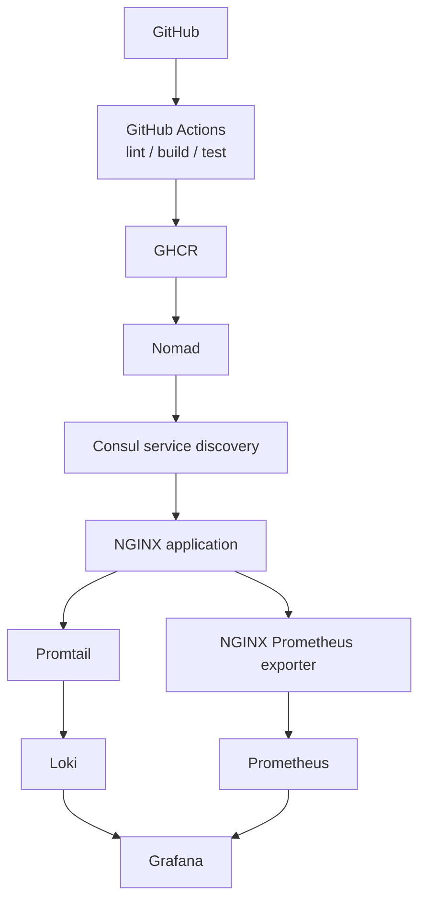
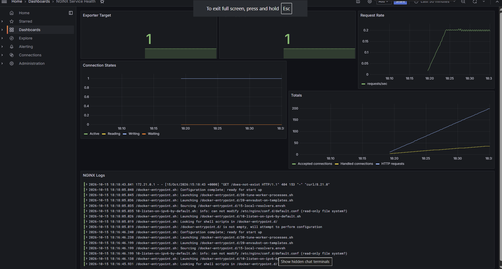

# DevOps Intern Final Assessment

**Built by:** Mahmoud Sameh Shams  
**Assessment date:** 2026-10-15

[](https://github.com/MSCloudDev/devops-intern-final/actions/workflows/ci.yml)

## Overview

This repository contains my final DevOps internship assessment. I built a small NGINX application, added a GitHub Actions pipeline, and prepared Nomad, Consul, Loki, Prometheus, and Grafana configuration around it.

The image build injects `BUILD_SHA` into the page. The repository is ready for local Docker validation. GitHub, Nomad, Consul, and monitoring evidence that needs a running external environment is marked below as **Not verified yet** rather than being presented as completed.

## Architecture



The local monitoring composition includes a Consul agent and a pinned exporter. The Nomad job itself is intentionally one group and one task as required by the assessment; an exporter is expected to run beside the allocation in the target environment. The current Nomad metrics registration points at the NGINX status endpoint, so the exporter registration still needs to be supplied by the deployment environment before Prometheus can scrape it there.

## Repository Structure

```text
app/                 NGINX image, page, and server configuration
scripts/             sysinfo and HTTP health-check scripts
.github/workflows/   GitHub Actions CI/CD workflow
nomad/               Nomad job specification
monitoring/          Compose stack and committed observability config
docs/screenshots/    Real evidence captured from running services
```

## Prerequisites

I used or pinned these versions in the repository:

| Tool | Version |
| --- | --- |
| Docker image base | `nginx:1.27.2-alpine3.20` |
| Prometheus | `v2.53.1` |
| Loki | `3.0.0` |
| Promtail | `3.0.0` |
| Grafana | `11.1.0` |
| NGINX exporter | `1.4.2` |
| Consul image | `1.20.1` |

Install Docker Desktop, Git, Nomad, Consul, and ShellCheck. ShellCheck was not installed on the Windows machine used for this setup, so that check is currently **Not verified yet** locally.

## Quick Start

```sh
git clone https://github.com/MSCloudDev/devops-intern-final.git
cd devops-intern-final
docker build --build-arg BUILD_SHA=local-validation -t devops-intern-final:local app
docker run --rm --name nginx-app -p 8080:8080 devops-intern-final:local
```

In another terminal:

```sh
curl http://localhost:8080/
curl http://localhost:8080/healthz
./scripts/healthcheck.sh http://localhost:8080
```

## Task 1 — Git and GitHub

The local repository was created with incremental commits and a feature branch. GitHub publication, a public repository, and a Pull Request cannot be performed from this unauthenticated local environment.

Required final commands after creating the remote:

```sh
git remote add origin https://github.com/MSCloudDev/devops-intern-final.git
git push -u origin main
git push -u origin feature/observability
gh pr create --base main --head feature/observability --title "feat: add observability stack" --body "Adds Loki, Promtail, Prometheus, Grafana, and dashboard provisioning."
# Review the PR in GitHub, then merge it.
git tag -a v1.0.0 -m "release: v1.0.0"
git push origin v1.0.0
```

Status: **Requires manual GitHub validation.** No token or credential is stored in this repository.

## Task 2 — Linux Scripting

Both scripts use `set -euo pipefail`. The health check defaults to `http://localhost:8080` and requires HTTP 200.

```sh
shellcheck scripts/*.sh
./scripts/sysinfo.sh
./scripts/healthcheck.sh http://localhost:8080
```

Observed local health-check output:

```text
Health check passed: http://localhost:8080/healthz returned HTTP 200
```

ShellCheck: **Not verified yet** because ShellCheck is not installed on the current Windows host.

## Task 3 — Containerisation

The image uses a pinned Alpine NGINX base, runs as the non-root `nginx` user, exposes port 8080, and contains a Docker health check. `/nginx_status` is restricted to loopback and private network ranges for the exporter path.

Commands used:

```sh
docker build --build-arg BUILD_SHA=local-validation -t devops-intern-final:local app
docker images devops-intern-final:local
docker run --rm --name nginx-app -p 8080:8080 devops-intern-final:local
curl -i http://localhost:8080/healthz
curl http://localhost:8080/
```

The build completed locally. The runtime check returned HTTP 200, and the page contained `local-validation`. Docker image inspection reported a local image size of `22,783,570` bytes (about 21.7 MiB), below the 60 MB target. The `docker images` display may include shared-layer accounting; `docker image inspect IMAGE --format '{{.Size}}'` is the size check I used.

## Task 4 — CI/CD

`.github/workflows/ci.yml` has four jobs:

1. `lint` runs ShellCheck and Hadolint.
2. `build` builds with `BUILD_SHA=${{ github.sha }}`.
3. `test` starts the image and runs `scripts/healthcheck.sh`.
4. `publish` runs only on pushes to `main` and publishes the SHA and `latest` tags to GHCR using `GITHUB_TOKEN`.

GitHub Actions and GHCR: **Not verified yet — requires a GitHub remote and Actions run.**

## Task 5 — Nomad and Consul

The job is a service job with one group and one Docker task. It uses a dynamic `http` port mapped to container port 8080, 100 MHz CPU, 64 MB memory, rolling update settings, restart policy, and reschedule policy.

Validate and plan it with the repository owner and SHA tag:

```sh
nomad fmt nomad/nginx-app.nomad.hcl
nomad job validate nomad/nginx-app.nomad.hcl
nomad job plan \
  -var='image_repository=ghcr.io/MSCloudDev/devops-intern-final' \
  -var='image_tag=GIT_SHA' nomad/nginx-app.nomad.hcl
nomad job run \
  -var='image_repository=ghcr.io/MSCloudDev/devops-intern-final' \
  -var='image_tag=GIT_SHA' nomad/nginx-app.nomad.hcl
nomad job status nginx-app
consul health service nginx-app
```

Local HCL validation passed. Allocation health and Consul health: **Not verified yet — no Nomad agent is running here.** The GHCR image must be public or the Nomad client must have registry credentials configured outside this repository.

## Task 6 — Logging with Loki

Start the committed configuration:

```sh
docker compose -f monitoring/docker-compose.yaml up -d
curl http://localhost:13100/ready
curl http://localhost:8080/does-not-exist
```

In Grafana Explore, use:

```logql
{job="docker", service="nginx-app"}
{job="docker", service="nginx-app"} |= " 404 "
```

The labels are `job`, `container`, `service`, and `nomad_job` when the Docker label exists. I verified Loki ingestion locally. The 404 query returned a stream labelled `job=docker`, `service=nginx-app`, with the line `GET /does-not-exist HTTP/1.1` and status `404`. The procedure and configuration are recorded in [monitoring/loki_setup.md](monitoring/loki_setup.md).

## Task 7 — Monitoring with Prometheus and Grafana

Prometheus uses Consul service discovery for `nginx-app-metrics`. The local Compose stack registers the pinned exporter in Consul; the exporter scrapes real NGINX `stub_status` data. The dashboard uses these real metrics rather than generated values:

- exporter target and `nginx_up`
- request rate
- active, reading, writing, and waiting connections
- accepted, handled, and total requests
- NGINX logs from Loki

I verified the local runtime path. Prometheus returned `up=1` for `nginx-exporter:9113`, `nginx_up=1`, and `nginx_http_requests_total=38` during the test. The exporter output also included the real connection-state and accepted/handled counters from NGINX `stub_status`.

### Grafana Dashboard

The dashboard is provisioned as `NGINX Service Health`, UID `nginx-service-health`, refreshing every 15 seconds with a 30-minute default range. The local Compose Grafana URL is `http://localhost:13000`. I opened the live dashboard and verified all six panel titles and real values in the browser.

The dashboard screenshot was captured from the running Grafana instance after generating application traffic and a 404 request.



## Troubleshooting

The first local `nomad job validate` failed because the reschedule policy set `attempts` while leaving Nomad's default `unlimited` value ambiguous. I fixed it by setting `unlimited = false`; validation then passed with only a `shutdown_delay` warning.

The first monitoring Compose attempt also hit a stale `nginx-app` container-name conflict and then a host port conflict with an existing Loki container. I removed only the validation container I had started and moved this project's monitoring ports to 13000, 13100, 18500, and 19090. Consul initially exited because its image needed a writable config mount; Loki initially rejected old Docker log timestamps. Both were fixed in the committed Compose/configuration files.

Other runtime troubleshooting: **Not recorded yet** because Nomad and the monitoring services have not been run in this environment.

## Known Limitations

- GitHub Actions and GHCR publication still require the remote workflow to run after these changes are pushed.
- Nomad allocation health requires a running Nomad agent and Linux Docker client.
- The one-task Nomad requirement does not launch an exporter sidecar. The local Compose stack demonstrates the exporter path; the Nomad environment needs the pinned exporter registered beside the allocation.
- This is an assessment environment, not a hardened production deployment. Secrets, TLS, persistent Prometheus storage, and multi-node failure handling are not included.

## Final Validation

| Requirement | Status | Evidence |
| --- | --- | --- |
| Git history / feature branch / PR / `v1.0.0` | Partial | Local history and remote PR history inspected |
| `sysinfo.sh` and `healthcheck.sh` | Partial | Health check ran; ShellCheck requires install |
| Docker image and non-root NGINX | PASS | Local build and HTTP smoke test |
| `BUILD_SHA` | PASS | `local-validation` appeared in page |
| GitHub Actions lint/build/test/publish | Not verified yet | Requires pushed workflow run |
| Nomad job validation | PASS | Local `nomad job validate` |
| Nomad allocation / Consul health | Not verified yet | Requires running agents |
| Loki / Promtail / LogQL 404 | PASS | Live Loki query returned the real 404 line |
| Prometheus / exporter / real metrics | PASS | Live target `up=1`, `nginx_up=1`, request counter |
| Grafana six-panel dashboard | PASS | Live dashboard and committed screenshot |
| Real screenshots | PASS | `docs/screenshots/grafana-nginx-dashboard.png` |
| README / troubleshooting / limitations | PASS | This document |
